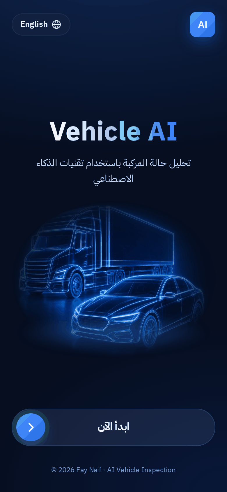
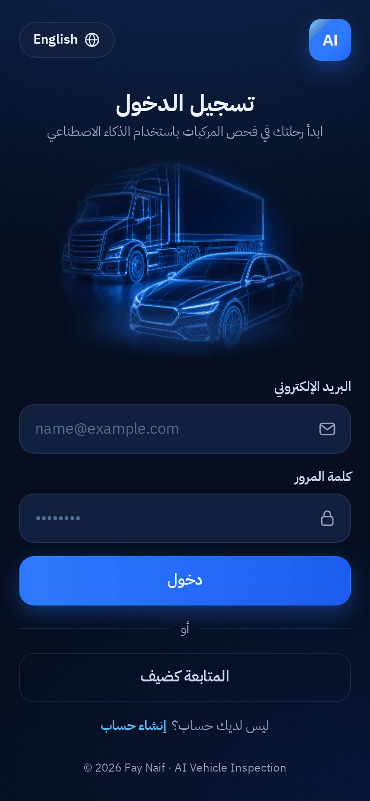
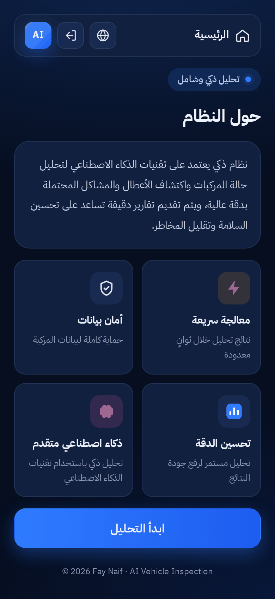
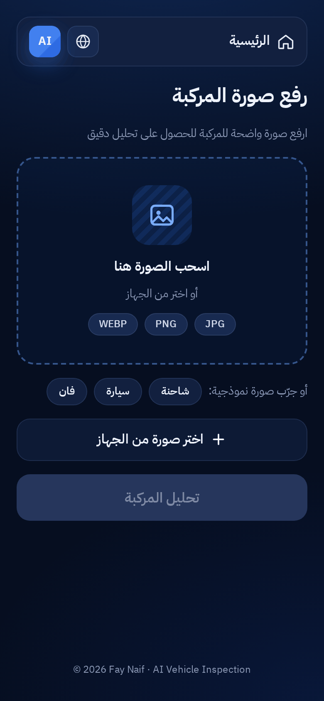
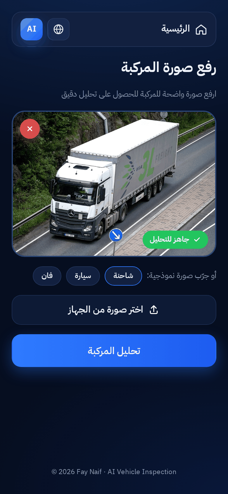
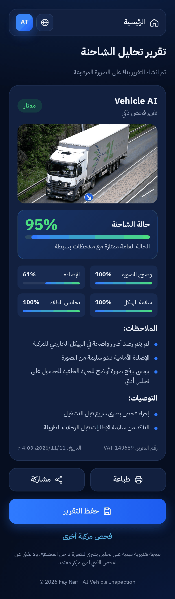
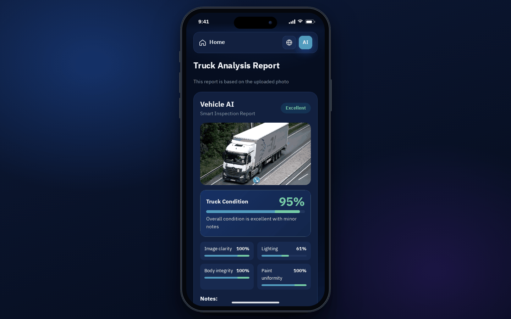
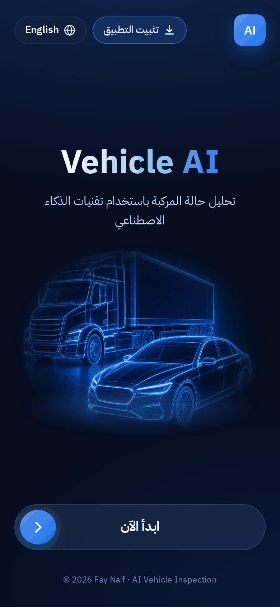

<h1 align="center">AI Vehicle Inspection</h1>
<p align="center"><b>فحص المركبات بالذكاء الاصطناعي</b></p>

<p align="center">
  
  
  
  
  
</p>

<p align="center">
  A bilingual (Arabic / English) web app that inspects a vehicle from a single photo and produces a clear condition report.
  <br>
  <a href="README_AR.md">اقرأ باللغة العربية</a>
</p>

---

## Overview

**AI Vehicle Inspection** lets a user sign in, upload a photo of a car or truck and get an instant inspection report: an overall condition score, a grade, notes about what was found in the photo and practical recommendations. The report can be printed, shared or saved.

Everything runs in the browser. Photos never leave the device and no server or API key is needed.

## Screenshots

| Splash | Sign in | About |
| :---: | :---: | :---: |
|  |  |  |

| Upload | Ready to analyze | Report |
| :---: | :---: | :---: |
|  |  |  |

**Desktop** – on wide screens the app is shown inside a phone frame

| Splash | Slide finished | Report |
| :---: | :---: | :---: |
|  |  |  |

| Install as an app |
| :---: |
|  |

## Features

- **Bilingual UI** – full Arabic (RTL) and English (LTR) with one-tap switching; the choice is remembered.
- **Splash screen** with a slide-to-start control that turns green with a tick when it reaches the end (mouse and touch).
- **Sign in / create account** with form validation (stored locally for the demo) and a guest option.
- **About the system** page with the four key features.
- **Photo upload** by drag & drop or file picker, with preview, remove button and a "ready to analyze" badge (JPG, PNG, WEBP up to 10 MB).
- **Sample photos** – real photos of a truck, a sedan and a van to try the app with one click (sources in [`assets/images/CREDITS.md`](assets/images/CREDITS.md)).
- **Inspection report**: condition score, grade (Excellent / Good / Needs attention), image indicators, notes and recommendations.
- **Print, share and save** the report (save downloads a text copy and keeps a local history).
- **Responsive** – full screen on phones; on tablets and desktops the app sits inside a realistic phone frame (pure CSS).
- **Installable app (PWA)** – add it to the home screen, opens full screen, works offline (service worker), back button moves between screens.
- **Works offline** – fonts, icons and images are bundled; no external requests.

## How the analysis works

The analysis is a lightweight, deterministic engine written in plain JavaScript (`js/services/analysis.js` + `js/services/image-metrics.js`). The photo is drawn onto a `<canvas>` and the app measures:

| Indicator | What is measured |
| --- | --- |
| Image clarity | Sharpness (mean absolute Laplacian) |
| Lighting | Average brightness compared to a well-exposed photo |
| Body integrity | Share of unusually high-contrast spots in the body area (scratches, dents) |
| Paint uniformity | Colour difference between the two halves of the body |

These indicators are combined into the overall score, and the notes and recommendations are chosen from them. The same photo always gives the same result. This is a visual estimate for demonstration and learning purposes. It is **not** a trained model and does not replace a technical inspection.

> When `index.html` is opened directly from disk, browsers block reading pixels of the bundled sample images. In that case the app uses the stored results in `js/services/sample-results.js` (produced by the same analyzer). Photos you upload are always analyzed live.

## Getting started

**Option 1 – just open it**

```bash
git clone https://github.com/<your-username>/AI-Vehicle-Inspection.git
cd AI-Vehicle-Inspection
# double-click index.html
```

**Option 2 – local server (recommended)**

```bash
python -m http.server 8000
# then open http://localhost:8000
```

**Deploy to GitHub Pages:** push the repository, then go to *Settings → Pages* and choose the `main` branch / root folder.

**Development**

```bash
npm test               # project checks (Node 18+, no dependencies)
npm run build:locales  # after editing locales/ar.json or locales/en.json
```

## Install as an app

Vehicle AI is a Progressive Web App: once installed it opens full screen from the home screen and works offline.

- **Android / Chrome / Edge:** open the site and tap **Install app** on the start screen (or *Install* in the browser menu).
- **iPhone / iPad (Safari):** tap **Share** → **Add to Home Screen**.
- **Desktop Chrome / Edge:** click **Install app**, or the install icon in the address bar.

Installing needs the site to be served over `https://` (GitHub Pages) or `http://localhost`. Opened straight from disk it runs as a normal page.

## Tech stack

- HTML5, CSS3 (custom properties, logical properties for RTL/LTR), vanilla JavaScript (ES2020)
- Canvas API for image analysis
- localStorage for session, language and report history
- Web App Manifest + Service Worker (installable, offline)
- History API for screen navigation
- [IBM Plex Sans Arabic](https://github.com/IBM/plex) font

## Project structure

```
AI-Vehicle-Inspection/
├── index.html                 # all screens (markup only)
├── manifest.webmanifest       # app name, colours, icons (PWA)
├── service-worker.js          # offline cache
├── package.json               # npm scripts: test, build:locales, start
├── css/
│   ├── main.css               # entry point – imports everything in order
│   ├── variables.css          # design tokens (colours, radii, shadows)
│   ├── base.css               # fonts, resets, app-like defaults
│   ├── layout.css             # app shell, screens, transitions, top bars
│   ├── components/            # buttons, forms, cards, slide-to-start, overlay, toast…
│   ├── screens/               # one file per screen
│   ├── rtl.css                # Arabic / English direction tweaks
│   ├── device-frame.css       # phone frame on tablet / desktop
│   └── print.css              # printed report
├── js/
│   ├── app.js                 # entry point – wires everything together
│   ├── router.js              # screens + browser history (back button)
│   ├── i18n.js                # translations + RTL / LTR switching
│   ├── generated/locales.js   # built from locales/*.json
│   ├── utils/                 # dom, format, image helpers
│   ├── services/              # analysis, image metrics, auth, storage, pwa
│   ├── ui/                    # reusable widgets (slider, toast, overlay…)
│   └── screens/               # splash, login, about, upload, report
├── locales/
│   ├── ar.json                # Arabic strings
│   └── en.json                # English strings
├── assets/
│   ├── fonts/                 # IBM Plex Sans Arabic (OFL)
│   ├── icons/                 # SVG icons + app/ (PWA icons)
│   └── images/                # logo, hero art, sample photos, CREDITS.md
├── scripts/build-locales.mjs  # locales/*.json → js/generated/locales.js
├── tests/project.test.mjs     # project checks (npm test)
├── docs/ARCHITECTURE.md
├── screenshots/
├── README.md · README_AR.md · LICENSE · .editorconfig · .gitignore
```

More detail on how the code is organised: [docs/ARCHITECTURE.md](docs/ARCHITECTURE.md).

## Author

**Fay Naif** – AI Programmer | UI/UX Designer

## License

Code released under the [MIT License](LICENSE). The vehicle photos are from Wikimedia Commons under their own Creative Commons licences – see [`assets/images/CREDITS.md`](assets/images/CREDITS.md).
