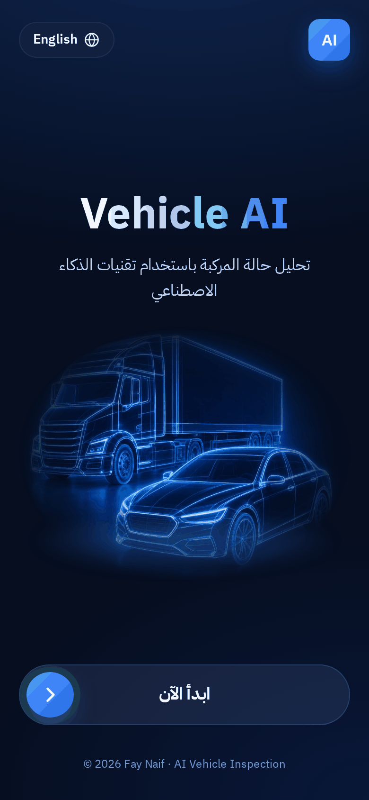
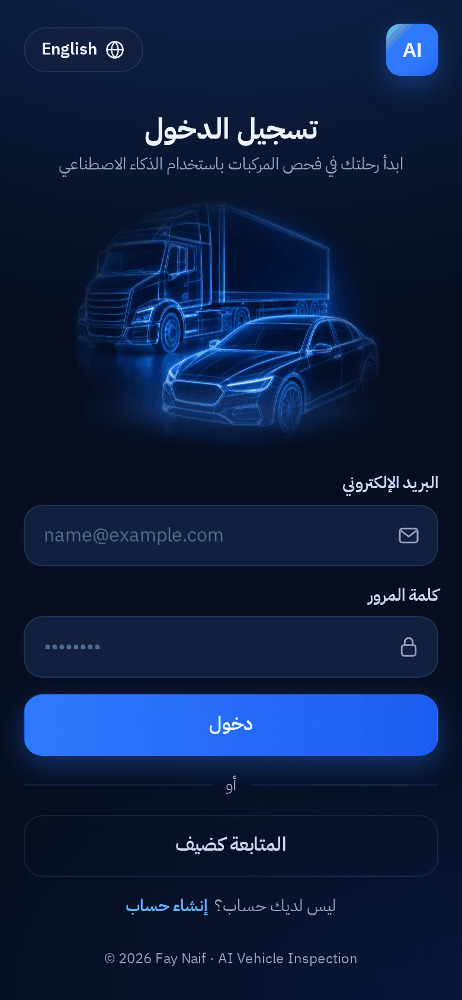
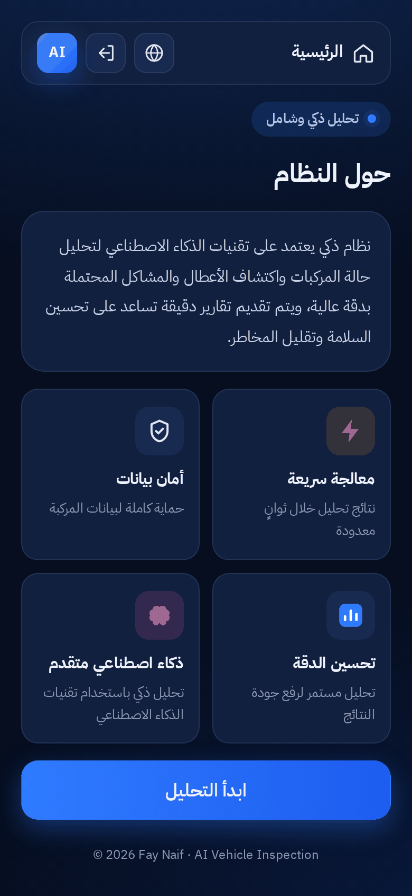
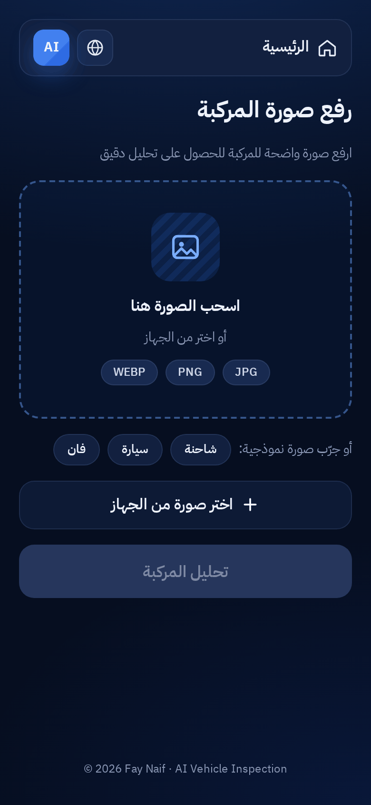
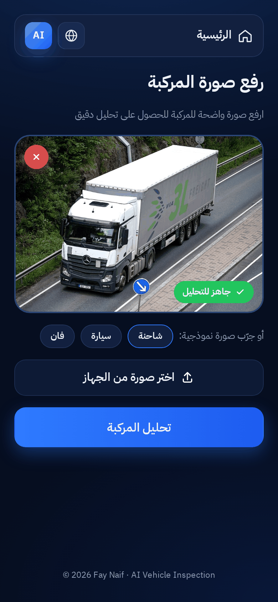
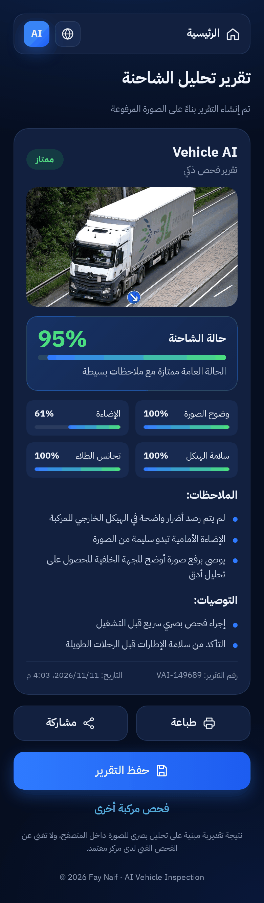
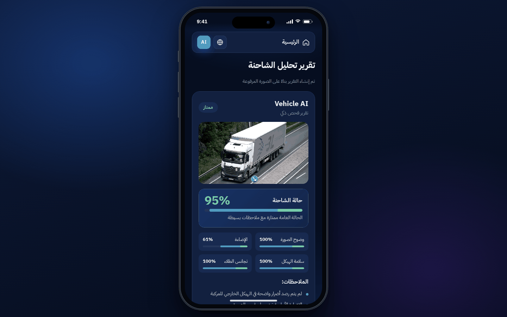
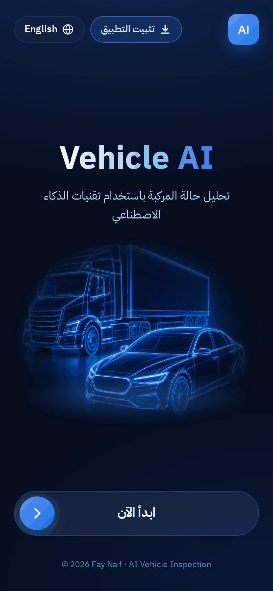

<div dir="rtl">

<h1 align="center">فحص المركبات بالذكاء الاصطناعي</h1>
<p align="center"><b>AI Vehicle Inspection</b></p>

<p align="center">
  
  
  
  
  
</p>

<p align="center">
  تطبيق ويب ثنائي اللغة (عربي / إنجليزي) يفحص المركبة من صورة واحدة ويعطيك تقريرًا واضحًا عن حالتها.
  <br>
  <a href="README.md">Read in English</a>
</p>

---

## نظرة عامة

يتيح **فحص المركبات بالذكاء الاصطناعي** للمستخدم تسجيل الدخول ورفع صورة لسيارة أو شاحنة، ثم الحصول فورًا على تقرير فحص يتضمن نسبة الحالة العامة والتقييم والملاحظات المستخرجة من الصورة وتوصيات عملية. ويمكن طباعة التقرير أو مشاركته أو حفظه.

يعمل كل شيء داخل المتصفح، فالصور لا تغادر جهازك ولا يحتاج التطبيق إلى خادم أو مفاتيح API.

## لقطات الشاشة

| البداية | تسجيل الدخول | حول النظام |
| :---: | :---: | :---: |
|  |  |  |

| رفع الصورة | جاهز للتحليل | التقرير |
| :---: | :---: | :---: |
|  |  |  |

**سطح المكتب**: على الشاشات الكبيرة يظهر التطبيق داخل إطار جوال

| الشاشة الافتتاحية | بعد السحب | التقرير |
| :---: | :---: | :---: |
|  |  |  |

| التثبيت كتطبيق |
| :---: |
|  |

## المميزات

- **واجهة بلغتين**: عربية (من اليمين لليسار) وإنجليزية (من اليسار لليمين) مع زر تبديل، ويتذكر التطبيق اختيارك.
- **شاشة بداية** بزر سحب «ابدأ الآن» يتحول للأخضر مع علامة صح عند وصوله للنهاية (بالماوس واللمس).
- **تسجيل الدخول وإنشاء حساب** مع التحقق من البيانات (تُحفظ محليًا للعرض التجريبي) وخيار المتابعة كضيف.
- **صفحة حول النظام** تعرض أهم أربع مميزات.
- **رفع صورة المركبة** بالسحب والإفلات أو من الجهاز، مع معاينة وزر إزالة وشارة «جاهز للتحليل» (JPG وPNG وWEBP حتى 10 ميجابايت).
- **صور نموذجية حقيقية** (شاحنة، سيارة، فان) لتجربة التطبيق بضغطة واحدة (المصادر في [`assets/images/CREDITS.md`](assets/images/CREDITS.md)).
- **تقرير الفحص**: نسبة الحالة، التقييم (ممتاز / جيد / يحتاج متابعة)، مؤشرات الصورة، الملاحظات والتوصيات.
- **طباعة ومشاركة وحفظ** التقرير (الحفظ ينزّل نسخة نصية ويحتفظ بسجل محلي).
- **متجاوب**: ملء الشاشة على الجوال، وعلى التابلت وسطح المكتب يظهر داخل إطار جوال واقعي (CSS فقط).
- **تطبيق قابل للتثبيت (PWA)**: يُضاف للشاشة الرئيسية ويفتح بملء الشاشة ويعمل بدون إنترنت، وزر الرجوع يتنقل بين الشاشات.
- **يعمل بدون إنترنت**: الخطوط والأيقونات والصور مضمّنة في المشروع.

## كيف يعمل التحليل

التحليل محرك خفيف ثابت النتائج مكتوب بـ JavaScript (`js/services/analysis.js` + `js/services/image-metrics.js`). تُرسم الصورة على `<canvas>` ثم يقيس التطبيق:

| المؤشر | ما يتم قياسه |
| --- | --- |
| وضوح الصورة | حدة الصورة (متوسط مُعامل لابلاس) |
| الإضاءة | متوسط السطوع مقارنة بصورة جيدة الإضاءة |
| سلامة الهيكل | نسبة المناطق عالية التباين في منطقة الهيكل (خدوش، انبعاجات) |
| تجانس الطلاء | فرق اللون بين نصفي الهيكل |

تُجمع هذه المؤشرات في النسبة العامة وتُختار الملاحظات والتوصيات بناءً عليها، والصورة نفسها تعطي النتيجة نفسها دائمًا. النتيجة تقدير بصري لأغراض العرض والتعلّم، وهي **ليست** نموذجًا مدرّبًا ولا تغني عن الفحص الفني.

> عند فتح `index.html` مباشرة من الجهاز يمنع المتصفح قراءة بكسلات الصور النموذجية، فيستخدم التطبيق النتائج المحفوظة في `js/services/sample-results.js` (الناتجة من المحلل نفسه). أما الصور التي ترفعها فتُحلَّل دائمًا مباشرة.

## طريقة التشغيل

**الطريقة الأولى: افتح الملف مباشرة**

```bash
git clone https://github.com/<your-username>/AI-Vehicle-Inspection.git
cd AI-Vehicle-Inspection
# افتح index.html بالضغط عليه مرتين
```

**الطريقة الثانية: خادم محلي (مُفضّلة)**

```bash
python -m http.server 8000
# ثم افتح http://localhost:8000
```

**النشر على GitHub Pages:** ارفع المستودع ثم من *Settings ← Pages* اختر فرع `main` والمجلد الرئيسي.

**للتطوير**

```bash
npm test               # فحوصات المشروع (Node 18+ بدون مكتبات)
npm run build:locales  # بعد تعديل locales/ar.json أو locales/en.json
```

## التثبيت كتطبيق

التطبيق Progressive Web App: بعد تثبيته يفتح بملء الشاشة من الشاشة الرئيسية ويعمل بدون إنترنت.

- **أندرويد / Chrome / Edge:** افتح الموقع واضغط **تثبيت التطبيق** في الشاشة الافتتاحية (أو *Install* من قائمة المتصفح).
- **آيفون / آيباد (Safari):** اضغط **مشاركة** ثم **إضافة إلى الشاشة الرئيسية**.
- **الكمبيوتر (Chrome / Edge):** اضغط **تثبيت التطبيق** أو أيقونة التثبيت في شريط العنوان.

التثبيت يحتاج أن يكون الموقع على `https://` (مثل GitHub Pages) أو `http://localhost`، وعند فتحه مباشرة من الجهاز يعمل كصفحة عادية.

## التقنيات المستخدمة

- HTML5 وCSS3 (متغيرات CSS وخصائص منطقية لدعم الاتجاهين) وJavaScript بدون مكتبات
- Canvas API لتحليل الصورة
- localStorage للجلسة واللغة وسجل التقارير
- Web App Manifest وService Worker (تثبيت وعمل بدون إنترنت)
- History API للتنقل بين الشاشات وزر الرجوع
- خط [IBM Plex Sans Arabic](https://github.com/IBM/plex)

## هيكل المشروع

</div>

```
AI-Vehicle-Inspection/
├── index.html                 # all screens (markup only)
├── manifest.webmanifest       # app name, colours, icons (PWA)
├── service-worker.js          # offline cache
├── package.json               # npm scripts: test, build:locales, start
├── css/
│   ├── main.css               # entry point – imports everything in order
│   ├── variables.css          # design tokens (colours, radii, shadows)
│   ├── base.css               # fonts, resets, app-like defaults
│   ├── layout.css             # app shell, screens, transitions, top bars
│   ├── components/            # buttons, forms, cards, slide-to-start, overlay, toast…
│   ├── screens/               # one file per screen
│   ├── rtl.css                # Arabic / English direction tweaks
│   ├── device-frame.css       # phone frame on tablet / desktop
│   └── print.css              # printed report
├── js/
│   ├── app.js                 # entry point – wires everything together
│   ├── router.js              # screens + browser history (back button)
│   ├── i18n.js                # translations + RTL / LTR switching
│   ├── generated/locales.js   # built from locales/*.json
│   ├── utils/                 # dom, format, image helpers
│   ├── services/              # analysis, image metrics, auth, storage, pwa
│   ├── ui/                    # reusable widgets (slider, toast, overlay…)
│   └── screens/               # splash, login, about, upload, report
├── locales/
│   ├── ar.json                # Arabic strings
│   └── en.json                # English strings
├── assets/
│   ├── fonts/                 # IBM Plex Sans Arabic (OFL)
│   ├── icons/                 # SVG icons + app/ (PWA icons)
│   └── images/                # logo, hero art, sample photos, CREDITS.md
├── scripts/build-locales.mjs  # locales/*.json → js/generated/locales.js
├── tests/project.test.mjs     # project checks (npm test)
├── docs/ARCHITECTURE.md
├── screenshots/
├── README.md · README_AR.md · LICENSE · .editorconfig · .gitignore
```

<div dir="rtl">

شرح أكثر لتنظيم الكود: [docs/ARCHITECTURE.md](docs/ARCHITECTURE.md)

## المطوّرة

**Fay Naif** – AI Programmer | UI/UX Designer

## الترخيص

الكود مرخّص بموجب [رخصة MIT](LICENSE)، وصور المركبات من Wikimedia Commons بتراخيص Creative Commons الخاصة بها (التفاصيل في [`assets/images/CREDITS.md`](assets/images/CREDITS.md)).

</div>
